# Robotics Multimodal MCAP Transformation & Client Delivery Pipeline

A production-grade, config-driven Python data engineering pipeline for ingesting high-volume multimodal robotics telemetry (RGB video metadata, aligned depth, 6-DoF IMU, and 14-DoF bimanual joint states), executing automated quality and VLM hand-segmentation gates, transforming episodes into bespoke frontier AI lab schemas, and packaging spec-compliant **`.mcap`** containers for petabyte-scale cloud object storage delivery (AWS S3 / GCS).

---

## System Architecture

```mermaid
flowchart LR
    subgraph Ingest ["1. Multi-Sensor Ingestion"]
        RGB["/camera/wrist_rgb (RGB8 + SAM2 Hand Mask)"]
        DEPTH["/depth/aligned_depth (16UC1)"]
        IMU["/imu/wrist (6-DoF Accel/Gyro)"]
        JOINTS["/robot/joint_states (14-DoF Bimanual)"]
    end

    subgraph QCGate ["2. Configurable QC & Segmentation Gate"]
        SYNC["Nanosecond PTP Sync Check (|t_rgb - t_imu| <= max_drift)"]
        HAND["VLM/SAM2 Hand-in-Frame Filter (conf >= client_threshold)"]
        FINITE["Joint NaN/Inf Zero-Order Hold Repair"]
    end

    subgraph Transform ["3. Declarative Schema Engine (configs/clients.yaml)"]
        CLIENT_A["Frontier Lab A: Dexterous (v2.4.0-dex)"]
        CLIENT_B["Frontier Lab B: Humanoid ROS2 (v1.8.2-ros2)"]
        CLIENT_C["Frontier Lab C: OpenX VLA (v3.1.0-openx)"]
    end

    subgraph Delivery ["4. MCAP Packaging & Object Storage"]
        MCAP["Spec-Compliant .mcap Container (zstd/lz4 chunked)"]
        S3["AWS S3 / GCS Multipart Delivery + SHA-256 Manifest"]
    end

    Ingest --> QCGate --> Transform --> Delivery
```



---

## Core Engineering Capabilities

1. **"Config-Over-Custom" Per-Client Schema Engine ([`configs/clients.yaml`](./configs/clients.yaml)):**
   - Every frontier lab requires different topic hierarchies, coordinate frames (`right_handed_z_up`, `ros_rep_103_flu`, `openx_embodiment_standard`), and container compression (`zstd` vs. `lz4`).
   - Onboarding a new customer or updating a field mapping requires only a declarative YAML block—zero pipeline code changes.
2. **Configurable VLM/SAM2 Hand-in-Frame Segmentation & Multi-Sensor Sync Gates ([`src/pipeline/mcap_engine.py`](./src/pipeline/mcap_engine.py)):**
   - Enforces per-client `min_hand_in_frame_confidence` thresholds (either dropping occluded frames or tagging them with occlusion metadata).
   - Validates cross-sensor nanosecond clock synchronization (`|t_rgb - t_imu| <= max_sensor_sync_drift_ms`) and automatically repairs transient `NaN`/`Inf` joint encoder dropouts using zero-order hold interpolation.
3. **Spec-Compliant Binary `.mcap` Container Writer & Verifier:**
   - Packs binary MCAP v0 containers (`\x89MCAP0\r\n` magic bytes, Header `0x01`, Schema `0x03`, Channel `0x04`, timestamped Message `0x05`, and CRC32 Footer `0x02`) and computes SHA-256 integrity digests and S3/GCS multipart storage economics.
4. **Interactive FastAPI Delivery Console ([`main.py`](./main.py) & [`static/index.html`](./static/index.html)):**
   - Live web UI to switch between Frontier Lab client profiles, tune hand-segmentation confidence thresholds, inject real-world sensor anomalies, inspect before/after payloads, and download the compiled `.mcap` file.

---

## Quickstart

### 1. Install Dependencies
```bash
python3 -m pip install -r requirements.txt
```

### 2. Run the Automated Test Suite
```bash
pytest -v
```

### 3. Run via CLI (Per-Client Delivery)
```bash
# Run with Frontier Lab A (Dexterous Manipulation, strict 0.85 hand-in-frame filter)
python3 -m src.pipeline.cli --client frontier_manipulation_lab --frames 120 --inject-occlusion --inject-nan

# Run with Frontier Lab B (Humanoid ROS2 schema, strict 2.0ms IMU sync gate)
python3 -m src.pipeline.cli --client embodied_navigation_lab --frames 120 --max-drift-ms 2.0
```

### 4. Launch the Interactive FastAPI Web Console
```bash
python3 -m uvicorn main:app --host 0.0.0.0 --port 8095
```
Then open **`http://localhost:8095`** in your browser.
